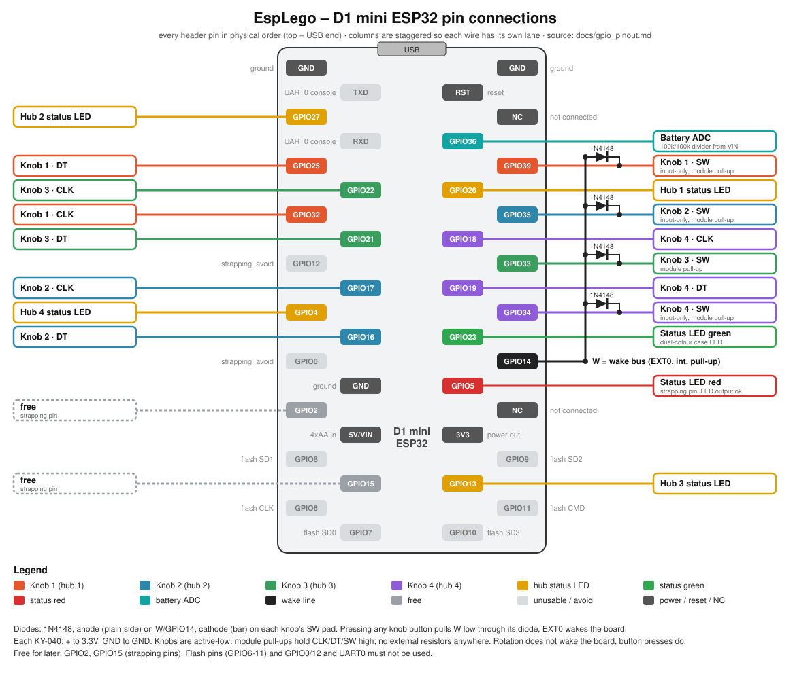

# GPIO pin plan (controls.yaml: train-controller.yaml and train-controller-dev.yaml)

This is the single source of truth for which GPIO is used for what on the dev
board, so future additions don't collide with anything already wired. Update
this file whenever a pin is assigned.

Board: Wemos-style **D1 mini ESP32** (ESP32-WROOM-32 module, classic ESP32, no
PSRAM). It breaks out fewer pins than a DevKitC - only the pins below exist on
the headers. Avoid strapping pins (0, 2, 5, 12, 15) for new outputs, flash pins
(6-11), and UART0 console pins (1, 3).

## Pin map by physical header column (top to bottom, as listed on the board)

| Header column | Pin | Function |
|---|---|---|
| Left outer | GPIO27 | Knob 3 CLK (wake) |
| | GPIO25 | Knob 1 DT (wake) |
| | GPIO32 | Knob 1 CLK (wake) |
| | GPIO4 | Knob 4 DT (wake) |
| | GPIO2 | free (strapping pin, RTC-capable) |
| Left inner | GPIO22 | Hub 1 / Hub 5 status LED (alternatives, shared) |
| | GPIO21 | Hub 2 status LED |
| | GPIO17 | Hub 3 status LED |
| | GPIO16 | Hub 4 status LED |
| | GPIO15 (TDO) | Knob 4 SW (wake, strapping pin) |
| Right inner | GPIO36 (SVP) | Battery voltage ADC (100k/100k divider from VIN) |
| | GPIO26 | Knob 3 DT (wake) |
| | GPIO18 | Couple Hubs button (to GND, internal pull-up, not a wake pin) |
| | GPIO19 | Stop All button (to GND, internal pull-up, not a wake pin) |
| | GPIO23 | Status LED - green |
| | GPIO5 | Status LED - red (strapping pin, output to an LED is fine) |
| | GPIO13 (TCK) | Knob 4 CLK (wake) |
| Right outer | GPIO39 (SVN) | Knob 1 SW (input-only, wake) |
| | GPIO35 | Knob 2 CLK (input-only, wake) |
| | GPIO33 | Knob 2 DT (wake) |
| | GPIO34 | Knob 2 SW (input-only, wake) |
| | GPIO14 (TMS) | Knob 3 SW (wake) |

Not usable: GPIO0 and GPIO12 (strapping - a pin held at wake would break boot),
GPIO1/3 (UART0), SD1/SDD/SD2/SD3/CLK/CMD (flash). GPIO37/38 are not broken out.
Still free: only **GPIO2** (strapping, RTC-capable). GPIO18/19 are the Couple and
Stop All buttons: wired between the pin and GND with the internal pull-up
(active-low), they work while the board is awake but cannot wake it from deep
sleep (not RTC pins) - a knob turn/press wakes it first.

## Knobs (one per hub, see `esphome/knob-package.yaml`)

| Knob | Hub | CLK | DT | SW |
|---|---|---|---|---|
| 1 | hub1 | GPIO32 | GPIO25 | GPIO39 |
| 2 | hub2 | GPIO35 | GPIO33 | GPIO34 |
| 3 | hub3 | GPIO27 | GPIO26 | GPIO14 |
| 4 | hub4 | GPIO13 | GPIO4 | GPIO15 |

Wiring for every KY-040 is **active-high**: module `+` to **GND** and module
GND to **3.3V** (the two power pins swapped), CLK/DT/SW to the pins. The module's
own resistors then act as pull-downs (lines idle low, go high on contact) and its
onboard debounce stays in place, so no internal or external resistor is needed
(and the input-only pins are fine). Bench-tested clean with
`esphome/knob-test.yaml`. Turning a knob steps its hub's current speed by `knob_step` (5 %) per
detent, so one full turn of a 20-detent KY-040 goes 0 to 100; pressing it stops that hub.

## Wake from deep sleep: turning or pressing any knob (EXT1 ANY_HIGH)

Classic ESP32 deep-sleep wake is EXT0 (one pin) or EXT1 (several, but only
`ANY_HIGH`/`ALL_LOW`). With the knobs active-high, **all 12 knob lines** (CLK, DT
and SW of every knob) are RTC-capable pins and form the EXT1 wake set with
`mode: ANY_HIGH` (`deep_sleep: esp32_ext1_wakeup` in `controls.yaml`).
A press or a turn drives a line high and wakes the board. Each line's idle-low
level comes from the KY-040's own pull-down, so ESPHome not setting any pull in
EXT1 doesn't matter. The click that wakes the board is lost (it reboots), so the
first turn only wakes, it doesn't change the speed. The hub status LEDs sit on
non-RTC pins (22, 21, 17, 16) to leave the RTC pins to the knobs.

## Design notes learned the hard way

- An earlier active-high attempt (encoder common to 3.3V, internal pull-down,
  module `+` left open) gave noisy, jumpy readings because the module's onboard
  debounce assumes its `+` pin is powered. Swapping the power pins instead
  (`+` to GND, GND to 3.3V) keeps that network working; it was measured clean.
- GPIO34-39 have no internal pulls, which is fine here (the module supplies the
  pulls). GPIO12 / GPIO0 must not be pulled the wrong way at boot, so they are
  not used.

## Other notes

- A fifth knob would need three more pins; only GPIO2 and GPIO15 (strapping)
  are free, so it would also need a hub/status LED moved or an I/O expander.

## Extra buttons

- **Couple Hubs (GPIO18):** toggles coupled mode; while coupled the connected hubs'
  status LEDs (GPIO22/21/17/16) blink together at 1 Hz instead of staying solid. Turning it on syncs every
  connected hub to the last knob speed; while coupled, any knob steps all hubs
  together and a knob click stops all. Turning it off leaves speeds as they are.
- **Stop All (GPIO19):** zeroes every hub and clears manual headlight overrides.

Both are exposed to HA/web as binary sensors, plus a "Hubs Coupled" state.
